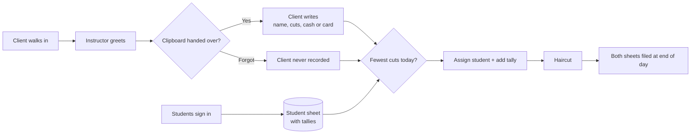

# Customer Discovery: Client Intake

## Customer
Top of the Line Barber School: front desk / clinic floor

## Who does this task
- Instructor (greets, hands out form, tallies cuts, assigns student)
- Client (fills out client sheet)
- Students (sign in on student sheet each day)

## How it works today
| # | Step | Who | Paper or computer | Time | Problems |
|---|------|-----|-------------------|------|----------|
| 0 | Students sign in for the day | Student | Paper (student sheet) | ? | |
| 1 | Greet client | Instructor | None | ? | |
| 2 | Hand client the clipboard | Instructor | Paper (client sheet) | ? | Forgotten when busy |
| 3 | Write name, number of cuts, cash or card | Client | Paper (client sheet) | ? | Skipped if step 2 is forgotten |
| 4 | Check tallies to find the student with the fewest cuts | Instructor | Paper (student sheet) | ? | Hard to keep up when busy |
| 5 | Assign client and add a tally mark | Instructor | Paper (student sheet) | ? | Tally can be missed |
| 6 | End of day: file both sheets | Instructor | Paper | ? | Missing clients never get recorded |

## Workflow map

## Biggest pain points
1. About 8 clients a day get served but never signed in
2. Haircut records are incomplete because of that
3. Instructor juggles two clipboards and tally marks while the floor is busy
4. Info only lives on paper, so it's hard to look up or count

## Things that can't change
- No legal paperwork required (no waivers or signatures)
- Must still capture: client name, number of cuts, cash or card
- Students still check in daily

## How we'll know it worked
- Clients served but not recorded: from about 8 per day to 0
- Intake time: from 2 minutes to 30 seconds
- Student rotation: tracked automatically instead of by tally marks
- Haircut records: from filed paper to searchable the same day

## Not doing (out of scope)
- Taking payments (only recording cash or card)
- Appointments or booking ahead

## What they said (no names)
- "Sometimes when the practical floor is busy, it's hard for me to remember." (Instructor)
