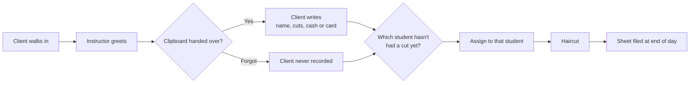

# Customer Discovery: Client Intake

## Customer
Top of the Line Barber School: front desk / clinic floor

## Who does this task
- Instructor (greets, hands out form, assigns student)
- Client (fills out form)

## How it works today
| # | Step | Who | Paper or computer | Time | Problems |
|---|------|-----|-------------------|------|----------|
| 1 | Greet client | Instructor | None | ? | |
| 2 | Hand client the clipboard | Instructor | Paper | ? | Sometimes forgotten |
| 3 | Write name, number of cuts, cash or card | Client | Paper | ? | Skipped if step 2 is forgotten |
| 4 | Figure out which student hasn't had a cut yet | Instructor | Memory | ? | Easy to lose track |
| 5 | Assign client to that student | Instructor | None | ? | |
| 6 | End of day: file the sign-in sheet | Instructor | Paper | ? | Missing clients never get recorded |

## Workflow map

## Biggest pain points
1. About 8 clients a day get served but never signed in
2. Haircut records are incomplete because of that
3. Info only lives on paper, so it's hard to look up or count
4. Instructor has to remember the student rotation

## Things that can't change
- No legal paperwork required (no waivers or signatures)
- Must still capture: name, number of cuts, cash or card

## How we'll know it worked
- Clients served but not recorded: from about 8 per day to 0
- Intake time: from 2 minutes to 30 seconds
- Haircut records: from filed paper to searchable the same day

## Not doing (out of scope)
- Taking payments (only recording cash or card)
- Appointments or booking ahead

## What they said (no names)
- TBD
