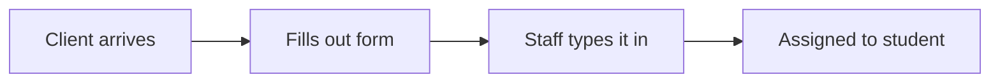

# Customer Discovery: Client Intake

## Customer
Top of the Line Barber School: front desk / clinic floor

## Who does this task
- The Instructor

## How it works today
| # | Step | Who | Paper or computer | Time | Problems |
|---|------|-----|-------------------|------|----------|
| 1 |      |Instructor|    Paper     |1 min |Repetitive and can miss clients from time to time|

## Workflow map

## Biggest pain points
1. Repetitive
2. Can miss clients from time to time
3. Only available to view on paper

## Things that can't change
- Anything can change for production

## How we'll know it worked
- Intake time: from 2 minutes to 30 seconds
- Mistakes: from 8 per day to 2

## Not doing (out of scope)
- 

## What they said (no names)
-
